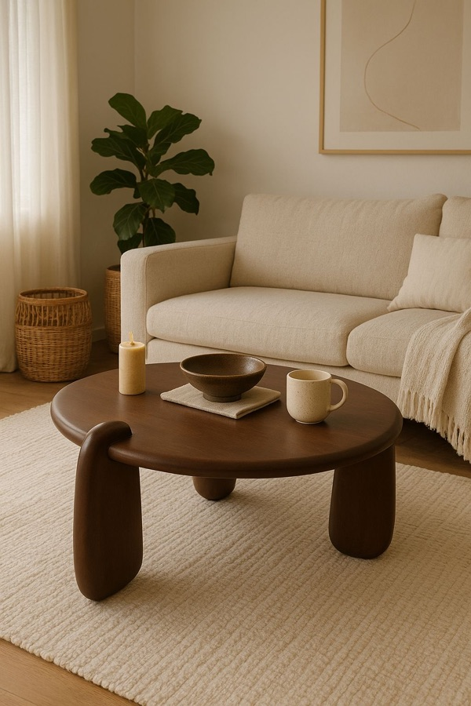
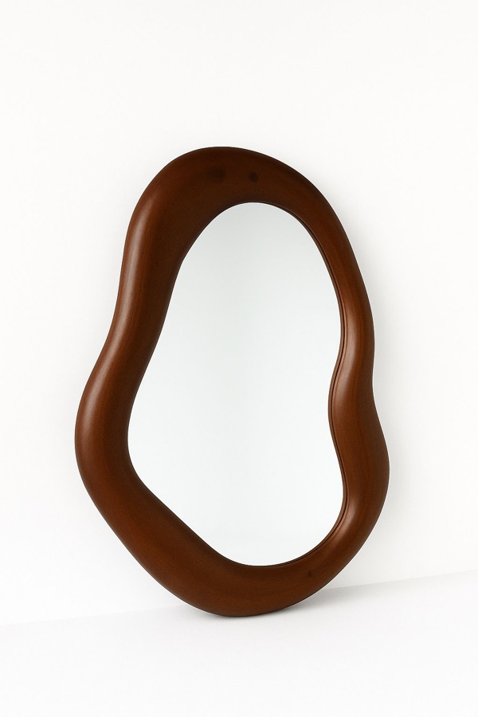
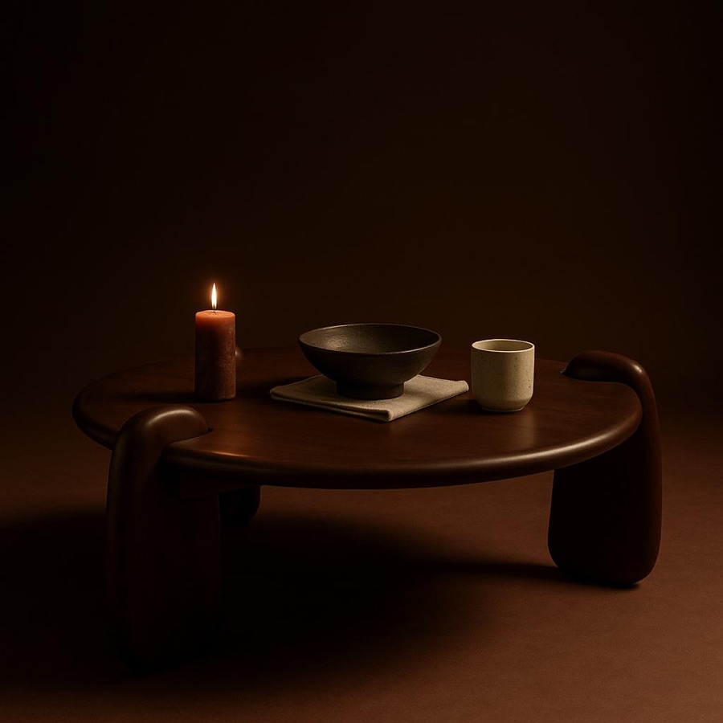

# Zuro — Furniture E-Commerce Store (Shopify)

**Zuro** is an Egyptian furniture brand making sculptural wooden pieces such as organic-shaped mirrors and coffee tables.
I built its online store from scratch on **Shopify**.

| | | |
| --- | --- | --- |
|  |  |  |

## What I built

- **Store setup:** Shopify store from scratch with a custom theme, navigation, homepage sections and brand styling
  (deep-brown and cream palette with the Zuro chair-"Z" logo)
- **Catalog:** products, variants, collections, product photography and descriptions
- **Commerce:** cart, checkout, shipping zones and payment settings for Egypt
- **Brand content:** lifestyle and product imagery and launch content for the store

## Tech

Shopify · Liquid theme customization · Shopify admin (products, collections, checkout, shipping)

> The store is currently offline, so this repository documents the project with brand and product images.
